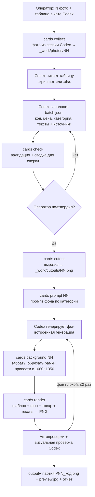
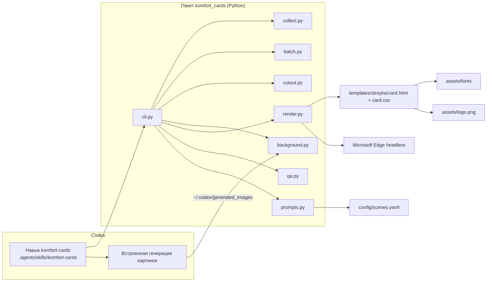

# Design: карточки товаров в дизайне Canva «Строительство и ремонт»

## Информация о документе

- **Фича**: canva-style-cards
- **Версия**: 1.0 (черновик на согласование)
- **Дата**: 2026-10-01
- **Связанные документы**: [requirements.md](requirements.md), [tasks.md](tasks.md)

## Обзор

Карточка собирается из трёх слоёв, у каждого свой исполнитель:

| Слой | Кто делает | Почему |
|---|---|---|
| Фон-сцена без товара | Codex, встроенная генерация по фиксированному промпту категории | Единственная часть, где нужна нейросеть; так выбрал владелец, генерация входит в подписку ChatGPT |
| Товар | Скрипт: вырезка с исходного фото и компоновка с тенью | Товар не перерисовывается, надписи на упаковке остаются чёткими |
| Дизайн-слой: тексты, плашки, логотип, код, цена, градиенты | Скрипт: HTML/CSS-шаблон, рендер системным Edge | Шрифты, размеры и позиции фиксированы кодом, поэтому одинаковы на всех карточках |

Codex — оркестратор. Он ведёт диалог с оператором, читает таблицу, пишет тексты, генерирует фоны, вызывает команды `cards.cmd` и визуально проверяет результат. Всё, что должно быть одинаковым, делает детерминированный код.

### Цели дизайна

- Пиксельное единообразие дизайн-слоя на всех карточках (NFR-1).
- Товар всегда с исходного фото (FR-4).
- Оператору не нужны ни терминал, ни файловые операции (NFR-5).
- Установка на чистый ПК двойным кликом (FR-10).

### Ключевые решения (подробно в разделе «Решения»)

- **D1.** Компоновка вырезки поверх сгенерированного фона вместо генерации товара в сцене.
- **D2.** Дизайн-слой и компоновка — HTML/CSS-шаблон, рендер Playwright через системный Microsoft Edge.
- **D3.** Фон рисует Codex по шаблону промпта из `config/scenes.yaml`.
- **D4.** Вложения из чата забираются из журнала сессии Codex, запасной путь — папка `input/`.
- **D5.** Вырезка — rembg, модель `isnet-general-use`, на CPU.
- **D6.** Окружение ставит uv: Python и зависимости одной командой, без прав администратора.

## Архитектура

### Поток партии



### Компоненты



### Технологии

| Слой | Технология | Обоснование |
|---|---|---|
| Окружение | uv + Python 3.12 (`pyproject.toml`, `uv.lock`) | Ставит Python и зависимости без прав администратора, воспроизводимо |
| Рендер | Playwright for Python, `channel="msedge"` | Настоящая типографика: кернинг, кириллица, точная подгонка. Edge есть в каждой Windows 10/11, браузер не скачивается |
| Шаблон | HTML + CSS + небольшой JS для подгонки текста | Дизайн правится в одном CSS-файле; JS возвращает метрики для QA |
| Вырезка | rembg (onnxruntime CPU), `isnet-general-use` | Справляется с белым товаром на белом фоне, где пороговая заливка ломается |
| Растровые операции | Pillow | Нормализация фона, превью, проверки |
| Таблица .xlsx | openpyxl | Если таблица пришла файлом |
| Конфиг сцен | YAML (PyYAML) | Владелец может править промпты без кода |

## Компоненты и интерфейсы

Codex вызывает все команды одной обёрткой из корня проекта: `.\cards.cmd <команда> [аргументы]`. Обёртка запускает `.venv\Scripts\python.exe -m komfort_cards`. Команды печатают человекочитаемый итог и последней строкой — `RESULT: {json}` для агента.

### C1. collect — забрать вложения из чата (FR-1)

- **Вход:** `--batch <id>` (по умолчанию новая партия с отметкой времени), `--count N` (ожидаемое число фото, если известно).
- **Алгоритм:**
  1. Находит самый свежий `~/.codex/sessions/**/rollout-*.jsonl`.
  2. Берёт **последнее** пользовательское сообщение с картинками. Пути берёт из `event_msg → item_completed → local_image.path` по порядку. Если файла по пути нет, декодирует base64 из `response_item → message(role=user) → input_image.image_url`.
  3. Копирует фото в `output/<id>/_work/photos/01.<ext> … NN.<ext>`, исходники не трогает.
  4. Если вложений нет, читает `input/` — файлы по имени в естественном порядке: 1, 2, …, 10.
- **Выход:** список файлов с размерами в пикселях. Если в сообщении есть картинка таблицы, Codex указывает её номер аргументом `--table-index K`: эта картинка копируется в `_work/table.png` и не считается фото товара.
- **Ошибки:** нет сессии, нет картинок или число не совпадает с `--count` → понятное сообщение и код выхода 2.

### C2. batch.json + check — данные партии и сверка (FR-2, FR-3, FR-8)

- `cards init --batch <id> --rows N` создаёт `batch.json` со скелетом N позиций.
- Codex заполняет позиции: код, название, цена, категория, тексты, источники.
- `cards check --batch <id>` проверяет схему и правила (раздел «Модель данных») и печатает markdown-сводку `№ | фото | код | название | цена | заголовок | плашка`. Эту сводку Codex показывает оператору.
- После «да» оператора Codex ставит `confirmed: true`. Команды `cutout`, `background` и `render` отказываются работать без подтверждения.

### C3. cutout — вырезка товара (FR-4)

- rembg `isnet-general-use`, сессия создаётся один раз на партию.
- Постобработка:
  - альфа-канал → удаление белой каймы: сжатие маски на 1 px и деконтаминация цвета краёв от белого;
  - обрезка по рамке альфы с полем 2%;
  - мелкие «острова» площадью меньше 0,2% удаляются.
- **Метрики:** доля непрозрачных пикселей, рамка, число «островов», касание рамки кадра (товар обрезан на исходнике).
- **Выход:** `_work/cutouts/NN.png` (RGBA) и `_work/cutouts/NN_check.jpg` — вырезка на тёмной шахматке для визуальной проверки.
- **Пороги needs_review:** покрытие < 3% или > 95%, больше 3 крупных «островов», касание края.

### C4. prompt + background — фон (FR-5)

- `cards prompt NN` собирает промпт: общий стиль из `config/scenes.yaml` + сцена и поверхность категории позиции. Codex передаёт промпт встроенной генерации без изменений смысла, можно лишь уточнить поверхность под форму товара.
- `cards background NN [--file <path>]` забирает фон:
  - явный файл, либо самый новый PNG в `~/.codex/generated_images/<thread-id текущей сессии>/`;
  - обрезает однотонную рамку 1–3 px по краям — так выглядели прошлые генерации 1122×1402;
  - масштабирует с обрезкой по центру до 1080×1350;
  - сохраняет `_work/backgrounds/NN.png`; предыдущие попытки — `NN_try1.png`, `NN_try2.png`.
- **Шаблон промпта (суть):** фотореалистичный фон для рекламной карточки; приглушённые, чуть тёмные тона; мягкий свет слева сверху; малая глубина резкости; камера на уровне глаз чуть выше поверхности; вертикаль 4:5; по центру спереди пустая видимая поверхность; верхние 30% и нижние 20% кадра спокойные и темнее. Запреты: товары, упаковка, люди, текст, буквы, логотипы, водяные знаки.
- **Категории сцен** (`config/scenes.yaml`, владелец может править):

| Ключ | Товары | Сцена | Поверхность |
|---|---|---|---|
| `dry_mix` | смеси, клеи, штукатурки, наливные полы | комната в ремонте: штукатурка, стопки плитки, инструмент | бетонный пол |
| `paint` | краски, эмали, грунтовки | помещение после ремонта: плёнка, стремянка, валики | деревянный верстак |
| `boards` | утеплитель, плиты, гипсокартон, OSB, фанера, кровля | большой склад стройматериалов: поддоны, стеллажи | бетонный пол склада |
| `sealants` | герметики, пена, клей в тубах | мастерская, инструмент на стене | деревянный верстак |
| `ventilation` | вентиляция, сантехника | светло-серая студия с мягкими зелёными формами | светло-серый пол |
| `tools` | инструмент, оборудование | стройплощадка или мастерская | бетонный пол |
| `auto` | автохимия | гараж или автомойка | пол гаража |
| `default` | прочее | нейтральный интерьер в ремонте | бетонный пол |

### C5. render — компоновка + дизайн-слой (FR-6, FR-7, FR-8)

- Для каждой позиции подставляет данные в `templates/stroyka/card.html`: `window.CARD = {...}` JSON-блоком. Страница открывается Playwright через Edge в окне 1080×1350 с масштабом 1.
- JS шаблона:
  - ждёт `document.fonts.ready`;
  - подгоняет тексты;
  - пишет `window.__metrics`: рамки элементов, итоговые кегли, флаги переполнения, рамку товара.
- Скриншот элемента `.card` сохраняется в `output/<id>/NN_<код>.png`. Если файл есть, пишется `NN_<код>_v2.png` (FR-8).
- Компоновка в шаблоне:
  - фон — `object-fit: cover`;
  - товар — `` из вырезки в рабочей зоне x 90–990, y от «низ белой плашки + 60» до 1040, `object-fit: contain`, прижат к низу. Может заходить до 40 px под зелёную плашку и нижний градиент, но не под код и цену (FR-6);
  - контактная тень — размытый эллипс под основанием, 70% ширины товара, чёрный 45%;
  - мягкая тень — `filter: drop-shadow(0 18px 24px rgba(0,0,0,.35))`;
  - переопределения на позицию: `layout.product_zone`, `layout.scale` (0.6–1.0), `layout.offset_y` — если поверхность на фоне выше или ниже.

#### Раскладка шаблона «stroyka» (снята с Canva, холст 1080×1350)

| Элемент | Шрифт | Кегль | Цвет | Позиция |
|---|---|---|---|---|
| Градиент сверху | — | — | чёрный 95% → 0% | y 0–430 |
| Градиент снизу | — | — | чёрный 0% → 92% | y 733–1350 |
| Заголовок | Open Sans 700, капслок, трекинг −0.02em | 93 → 58 по ширине 924; при нехватке 2 строки | #FFFFFF, тень 0 2 12 rgba(0,0,0,.35) | left 78, top 84 |
| Акцентное слово (опц.) | как заголовок | — | #7ABB29 | внутри заголовка |
| Строка-подзаголовок (опц., вариант A) | Open Sans 400, капслок | 53 → 36 | #FFFFFF | left 78, под заголовком |
| Белая плашка (вариант B) | Montserrat 700 капслок (вторая строка — Montserrat 400, ×0.88) | 40 → 26 (в Canva стр. 97 — 40.6 с учётом масштаба текстового блока) | #000 на #FFF, радиус 6, поля 16/32 | left 78, top = низ заголовка + 18 |
| Зелёная плашка (опц.) | значение Open Sans 700; подпись Montserrat 400, текст с тенью 0 1 6 rgba(0,0,0,.25) | 48 → 28; 29 | #FFF на `radial-gradient(circle farthest-corner, #7ABB29 88% → #7EBC30 50%)`, радиус 6, `backdrop-filter: saturate(.35)` — подложка обесцвечивается без размытия, чтобы на тёплом фоне не было «хаки». В Canva 100% → 63.5%; по просьбе владельца прозрачнее, как на стр. 52 | left 89, top 1028, 341×147 |
| Значок «+» | крест 24×24, штрих 3 px | — | #55574F на #FFF, рамка 1.5 px #76726A, радиус 4 (на белой плашке — белый крест на зелёном) | left 66, top 1006, 44×44 |
| Логотип | файл `assets/logo.png` (белый, прозрачный фон, 1852×343) | ширина 219 | — | left 101, top 1206 |
| Код | Montserrat 400 | 45 | #FFF | правый край 998, top 1086 |
| Цена | Montserrat 700 | 110 → 80 (как в «К: УЛИЦА»; +21% к «К: РЕМОНТ» по просьбе владельца +20–30%) | #FFF, тень | правый край 933, строка top 1142 (высота 134), верх цифр ≈ 1172 |
| Знак ₸ | SVG (2 планки 8/9 px + ножка 13 px) | 41×56 — около 73% высоты цифр, как «т» + «_» в Canva | #FFF | left 957, top 1188, низ на 4 px выше базовой линии цены, правый край 998 |

**Поправка замеров от 2026-10-02.** Canva масштабирует текстовые блоки, и первый замер это не учитывал. С масштабом:
- цена — 110.5 px и в «К: РЕМОНТ», а не 91;
- белая плашка — 40.6 px;
- «т» в знаке ₸ — 80 px.

Нашёл это дизайн-критик (отдельный агент), перепроверено через DOM.

**Защита читаемости.** Рендер меряет яркость фона:
- в зоне заголовка (y 60–330);
- в зоне подвала (x 440–1080, y 1060–1290).

Если она выше 0.40, градиенты усиливаются (классы `boost-top` и `boost-bottom`).

**Зазор товара и плашки.** Низ товара над плашкой не попадает в полосу 990–1070: товар либо выше плашки с зазором, либо явно за ней.

#### Варианты оформления внутри шаблона (FR-15)

Главный шаблон — проба v7 (`prototype/card-v7.html`). Codex может выбирать варианты, но не трогает шрифты, цвета и позиции кода, цены и логотипа.

| Вариант | Как выглядит | Когда |
|---|---|---|
| Подзаголовок `badge` | Белая плашка, чёрный Montserrat 700 капслок (как v7) | По умолчанию: модель, серия, назначение |
| Подзаголовок `line` | Строка белого текста Open Sans 400 капслок 53 → 36 без плашки (как стр. 2) | Когда подзаголовок — одно слово-уточнение («ТЕПЛОИЗОЛЯЦИОННАЯ») |
| Иконки-свойства `row` | 1–3 белых скруглённых чипа под подзаголовком: тёмная иконка 30 px + Montserrat 700 капслок 26 px (как стр. 33 «⌀ ДИАМЕТР: 100ММ») | Короткие свойства, когда товар высокий |
| Иконки-свойства `column` | До 3 строк слева: белый круг 60 px с тёмной иконкой + белый текст Montserrat 700 28 px справа, шаг 84 px, начало x 78. Зона товара сдвигается вправо | Когда товар широкий и слева есть место |

**Словарь вариаций из «К: УЛИЦА»** (https://canva.link/19fvetfh275n1z0, замер 2026-10-01). Это то, как владелец сам отходит от базы.

| Элемент | Вариации | Пример |
|---|---|---|
| Плашка параметра (низ слева, 341×147) | Зелёная (по умолчанию) — белый текст. Белая — `radial-gradient(circle farthest-corner, #FFF 100% → #FFF 63.5%)`, значение зелёным #7ABB29 Open Sans 700, подпись чёрным Montserrat 400; берётся, когда товар или фон зелёные. Однострочная без «+» («ОДНОКОЛЁСНАЯ», Montserrat 700 40 чёрный) | стр. 17, 31, 44 |
| Значок «+» | На зелёной плашке — белый квадрат с тёмным «+»; на белой — зелёный квадрат с белым «+»; может отсутствовать | стр. 17, 31 |
| Под заголовком | Строка белого текста Open Sans 700 44–48 капслок; белый бейдж с брендом или моделью (Open Sans 700 39 капслок); бейдж «подпись + значение» (Montserrat 400 33 + 700 33: «грузоподъемность **250 кг**»); зелёный полупрозрачный бейдж с ключевой цифрой (Open Sans 400/700 52: «ДО **270 КГ**»). Комбинируются по 1–2 | стр. 17, 44, 47 |
| Заголовок | 1–2 строки, вторая может быть мельче (70 / 57); бренд в «» выделяется зелёным #7ABB29 | стр. 2, 14, 44 |
| Выноски у частей товара | Маленькие белые полупрозрачные бейджи (Montserrat 700 33 или список Montserrat 400 33) с зелёным «+» в углу, рядом с предметом. Только для наборов и нескольких предметов | стр. 6, 14 |
| Несколько позиций (FR-14) | До 3 зелёных строк-пилюль снизу (`radial #BCE49F → #7ABB29`, 660×95, шаг 138): название Open Sans 700 36–40 + «КОД: …» Open Sans 400 24 + цена Montserrat 700 67 + ₸; логотип при этом может скрываться | стр. 6, 14, 36 |

Неизменно во всех вариациях: шрифты Open Sans и Montserrat, зелёный #7ABB29, белый, чёрный, тёмные градиенты сверху и снизу, позиции кода, цены и логотипа.

- **Иконки** — фиксированный набор SVG в `assets/icons/` (Lucide, лицензия ISC):
  - вес, объём, размер, диаметр, площадь/расход;
  - мощность, напряжение, температура;
  - влагостойкость, морозостойкость, УФ;
  - время высыхания, количество в упаковке;
  - для помещений, для улицы.

  Codex выбирает иконку по ключу из `config/icons.yaml` и не рисует свои.
- **Ограничения** проверяет `qa`:
  - не больше 3 иконок-свойств и до 24 символов на подпись;
  - рамка товара ≥ 25% холста;
  - иконки и подписи не пересекают товар.

**Правила текста:**
- только уменьшение кегля в пределах таблицы, затем перенос; масштабирование по X запрещено (FR-7);
- цена — группы по 3 цифры через пробел, без копеек, если их нет в таблице;
- код выводится как строка из таблицы, без преобразования в число.

**Замеры Canva (2026-10-01):**
- ширины заголовков «ПЛИТА “ТЕПЛЕКС”» 93 px → 861, «ГРУНТОВКА КОНЦЕНТРАТ» 68 px → 890, «ГИПСОКАРТОН «KNAUF»» 68 px → 861;
- Open Sans из Google Fonts даёт ±1.5% к этим ширинам, то есть метрики совпадают;
- трекинг −0.02em взят по замечанию владельца и по стр. 52 эталона, где стоит −2.2 px при 67 px.

### C6. qa — контроль качества (FR-9)

- **Автопроверки после рендера** (из `__metrics` и файла):
  - размер 1080×1350;
  - нет флагов переполнения;
  - кегль не ниже минимума;
  - код и цена непустые;
  - рамка товара в рабочей зоне, площадь ≥ 12% холста;
  - нет пересечения товара с заголовком и плашкой (допуск 8 px);
  - фон нормализован и рамки обрезаны.
- `preview.jpg` — лист всех карточек партии 4 в ряд с номерами.
- Итоговый статус позиции в `batch.json`:
  - `rendered` → `approved` после визуальной проверки Codex;
  - `needs_review` с причиной;
  - `blocked` — нет данных или фото.

### C7. Навык Codex `komfort-cards` (FR-1…FR-9, FR-13)

`.agents/skills/komfort-cards/SKILL.md` — пошаговая процедура по потоку выше. Жёсткие правила:
- цены и коды только из таблицы;
- сверка до генерации;
- фон — только по `cards prompt`, без текста и товара;
- максимум 2 перегенерации фона;
- не перезаписывать файлы;
- отчёт в конце.

`references/` навыка:
- `design-rules.md` — что можно менять в текстах;
- `text-rules.md` — как писать заголовок, плашки и что выносить на зелёную плашку, с примерами из эталона;
- `qa-checklist.md`.

`AGENTS.md` переписывается: маршрутизация на `komfort-cards`, правила сохранности данных. Правило git commit/push применяется только к изменениям самой системы, не к партиям: они в `.gitignore`. Старый навык `marketplace-product-cards` и скрипты старого потока переносятся в `legacy/`, вне `.agents/skills`, поэтому Codex их не подхватывает. Незакоммиченные правки в них сохраняются отдельным коммитом.

### C8. Установка и обновление (FR-10, FR-11, FR-12)

`УСТАНОВКА.bat` (двойной клик) → `scripts\setup.ps1 -ExecutionPolicy Bypass`:
1. Проверяет uv; если нет — ставит официальным установщиком в профиль пользователя, без прав администратора.
2. `uv sync --frozen` — ставит Python 3.12 и зависимости в `.venv`.
3. Скачивает модель вырезки: `cards setup-models`.
4. Проверяет Edge. Если его нет, запускает `playwright install chromium`.
5. Выполняет `cards selftest`: рендер карточки из `assets/selftest/` в `output/_selftest/card.png` с проверкой размеров и метрик.
6. Пишет итог на русском. Лог — `setup.log`. Окно не закрывается до нажатия клавиши.

Повторный запуск безопасен: каждый шаг проверяет, сделан ли он.

`ОБНОВЛЕНИЕ.bat`: если есть git и папка — клон, выполняет `git pull --ff-only`, иначе выводит инструкцию скачать ZIP. Затем `uv sync --frozen` и `cards selftest`.

`README.md` — инструкция оператора: установка, «как сделать карточки» (3 шага), где результат, типовые ошибки.

## Модель данных

### batch.json

| Поле | Тип | Обяз. | Описание |
|---|---|---|---|
| `batch_id` | string | да | `YYYY-MM-DD_HHMM[_метка]` |
| `template` | string | да | `stroyka` |
| `created_at` | ISO datetime | да | |
| `table_source` | `screenshot` \| `xlsx` | да | Откуда прочитана таблица |
| `confirmed` | bool | да | Оператор подтвердил сводку |
| `items[]` | Item | да | N позиций, порядок = порядок фото |

### Item

| Поле | Тип | Обяз. | Правила |
|---|---|---|---|
| `n` | int | да | 1…N |
| `code` | string | да | Непустой, как в таблице, без нормализации |
| `name` | string | да | Название из таблицы |
| `price` | string | да | Только цифры, пробелы и запятая; в шаблоне форматируется |
| `category` | string | да | Ключ из `scenes.yaml` |
| `photo` | path | да | `_work/photos/NN.*`, файл существует |
| `photo_note` | string | нет | Что Codex видит на фото — коротко, для сводки сверки (FR-2) |
| `photo_crop` | `[x0, y0, x1, y1]` в долях 0..1 | нет | Обрезка фото до вырезки, когда на нём кроме товара есть коробка, второй предмет или инфографика (найдено на реальных фото 2026-10-01) |
| `texts.title` | string | да | ≤ 40 символов |
| `texts.title_accent` | string | нет | Подстрока заголовка, выделяется зелёным |
| `texts.subtitle` | string | нет | Вариант A: белая строка |
| `texts.badge` | string[] | нет | Вариант B: 1–2 строки белой плашки |
| `texts.plate` | `{value, label}` | нет | Значение ≤ 12 символов, подпись ≤ 20 |
| `texts.subtitle_style` | `badge` \| `line` | нет | По умолчанию `badge` (FR-15) |
| `texts.features` | `[{icon, text}]` | нет | 0–3 элемента; `icon` — ключ из `config/icons.yaml`, `text` ≤ 24 символов |
| `texts.features_layout` | `row` \| `column` | нет | По умолчанию `row` |
| `sources` | map поле → `table` \| `packaging` \| `komfort.kz` \| `knowledge` | да | Для каждого заполненного текста; числа не могут иметь источник `knowledge` |
| `layout` | `{product_zone?, scale?, offset_y?}` | нет | Переопределения компоновки |
| `status` | enum | да | `planned` \| `cut` \| `bg_ready` \| `rendered` \| `approved` \| `needs_review` \| `blocked` |
| `issues` | string[] | нет | Причины `needs_review` и `blocked` |
| `files` | `{cutout, background, card}` | нет | Пути артефактов |

Пример позиции:

```json
{
  "n": 1, "code": "1509373", "name": "Клей GERMIX GM-245 PRO", "price": "4880",
  "category": "dry_mix", "photo": "_work/photos/01.png",
  "texts": {"title": "Клей GERMIX GM-245 PRO", "badge": ["Для керамогранита и тёплого пола"],
            "plate": {"value": "25 кг", "label": "фасовка"}},
  "sources": {"title": "table", "badge": "packaging", "plate.value": "packaging"},
  "status": "planned"
}
```

### Структура папок

```text
Komfort/
  УСТАНОВКА.bat, ОБНОВЛЕНИЕ.bat, cards.cmd
  pyproject.toml, uv.lock, .python-version
  AGENTS.md, README.md
  komfort_cards/          cli, collect, batch, cutout, background, prompts, render, qa
  templates/stroyka/      card.html, card.css
  assets/fonts/           OpenSans, Montserrat (+ OFL.txt)
  assets/logo.png         логотип владельца
  assets/selftest/        процедурный фон и товар для самопроверки
  config/scenes.yaml
  .agents/skills/komfort-cards/
  scripts/setup.ps1, scripts/update.ps1
  tests/
  legacy/                 старый поток (не используется Codex)
  input/   (gitignore)    запасной путь для фото
  output/  (gitignore)    партии: output/<id>/NN_код.png, preview.jpg, batch.json, _work/
```

## Обработка ошибок

| Ситуация | Реакция системы | Что видит оператор |
|---|---|---|
| Нет вложений в сессии и пустой `input/` | collect: код 2 | «Не вижу фото. Прикрепите их в этот чат ещё раз или положите в папку input» |
| Фото ≠ строк | collect/check: код 2 | «Фото: 4, строк в таблице: 5 — проверьте набор» |
| Нет кода или цены | check: блокирует | Строка помечена в сводке, вопрос оператору |
| Фото не похоже на название | Codex помечает в сводке | Вопрос «на фото 3 ведро краски, в строке 3 — клей. Верно?» |
| Вырезка плохая | `needs_review` + `NN_check.jpg` | Строка в отчёте с причиной |
| Фон с текстом или товаром, плохая поверхность | ≤ 2 перегенерации, затем `needs_review` | Строка в отчёте |
| Переполнение текста | render: метрика, `needs_review` | Codex сокращает текст и перерендеривает |
| Нет логотипа | Текстовая заглушка + предупреждение | «Логотип не найден: assets/logo.png» |
| Edge не найден | Fallback на Chromium Playwright, если установлен | В установке: «ставлю браузерный движок» |
| Формат журнала Codex изменился | collect падает с понятной ошибкой | Совет положить фото в `input/` |

Все команды пишут лог в `output/<id>/_work/log.txt`. Исключения не глотаются: сообщение на русском плюс технические детали в лог.

## Безопасность и данные

- Читаются только файлы текущего пользователя: сессии и генерации Codex, только картинки последнего сообщения. Переписка не копируется.
- Сеть: только установка (uv, PyPI, модель) и Codex (генерация, необязательный komfort.kz). Рендер офлайн.
- Секретов нет. `output/`, `input/`, `.venv/`, `*.xlsx`, `setup.log` — в `.gitignore`.
- Исходники фото копируются, оригиналы не изменяются (NFR-4).

## Решения

### D1. Товар: компоновка вместо генерации в сцене

- **Варианты:**
  1. Генерация товара в сцене по фото-референсу. Плюсы: естественное встраивание. Минусы: перерисовка упаковки, кривые надписи, на стройтоварах много мелкого текста; вариативность.
  2. Вырезка оригинала поверх сгенерированного фона. Плюсы: товар точный; так же сделаны карточки эталона (стр. 84, 97 — отдельный слой товара поверх фона). Минусы: нужна правдоподобная тень и подходящая поверхность.
- **Решение:** вариант 2. Ограничение «приклеенности» снимается промптом с пустой поверхностью и контактной тенью.

### D2. Дизайн-слой: HTML/CSS + Edge вместо Pillow

- **Варианты:**
  1. Pillow ImageDraw. Минусы: нет полноценного кернинга без libraqm, неудобная подгонка и переносы.
  2. HTML/CSS через Playwright и системный Edge. Плюсы: типографика браузера, правки дизайна в CSS, метрики из JS. Минусы: зависимость от Edge — есть в Windows 10/11, есть fallback.
- **Решение:** вариант 2. Проверено пробой 2026-10-01: headless Edge отрисовал карточку 1080×1350 с нужными шрифтами.

### D3. Фон: Codex по шаблону промпта

- Выбор владельца. Промпт не пишется заново на каждую карточку, а собирается из `scenes.yaml`. Одна категория — один промпт, отсюда одинаковые свет, тон и высота камеры в партии.

### D4. Вложения: журнал сессии Codex

- Проверено на этом ПК: вставленные картинки лежат в `%TEMP%\codex-clipboard-*.png`, пути — в rollout как `local_image`, base64 — в `input_image`.
- Это внутренний формат, поэтому есть fallback через `input/` и понятная ошибка.

### D5. Вырезка: rembg isnet-general-use

- Порог по белому ломается на белых вёдрах и мешках. rembg проверен в сообществе. Если установка окажется тяжелее 10 минут, переходим на прямой onnxruntime с той же моделью без лишних зависимостей. Решение принимается в TSK-005 по замеру.

### D6. Окружение: uv

- Один инструмент ставит Python нужной версии и зависимости по lock-файлу, не требует прав администратора и PATH-настроек от оператора.

## Стратегия тестирования

| Уровень | Что | Как |
|---|---|---|
| Unit | Валидация `batch.json`, форматирование цены и кода, сборка промпта, нормализация фона (обрезка рамки, crop 4:5) | pytest |
| Unit | collect на синтетическом rollout: пути есть / только base64 / нет картинок | pytest + временные файлы |
| Unit | cutout на синтетике (фигура на белом, белая фигура на белом) | pytest, пороги покрытия |
| Integration | render: позиции элементов из `__metrics` совпадают с таблицей раскладки (±2 px), кегли в пределах, без переполнений | pytest + Playwright/Edge |
| Golden | selftest-карточка сравнивается с эталонным PNG (средняя разница < 2/255) | pytest |
| Визуальная | Пробная партия из 3–5 реальных товаров; сравнение с эталоном Canva бок о бок | Ручная приёмка владельцем |
| Установка | `УСТАНОВКА.bat` на этом ПК (Python не установлен — чистая среда) | Ручной прогон, лог |
| E2E в Codex | Оператор прикрепляет фото и таблицу → карточки | Приёмка владельцем в Codex |

## Трассировка

| Требование | Компоненты |
|---|---|
| FR-1 | C1, C7 |
| FR-2 | C2, C7 |
| FR-3 | C2, C7 (`text-rules.md`) |
| FR-4 | C3 |
| FR-5 | C4, C7 |
| FR-6 | C5 |
| FR-7 | C5 (шаблон) |
| FR-8 | C5, C6 |
| FR-9 | C6, C7 |
| FR-10, FR-11, FR-12 | C8 |
| FR-13 | C7 |
| FR-14 (Could) | C5 — вариант шаблона `multi`, в последней фазе |
| FR-15 (Should) | C5 — варианты подзаголовка и иконки-свойства; C6 — ограничения; C7 — правила выбора в `text-rules.md` |
| NFR-1…NFR-7 | C5 / C3, C5 / C5 / C1, C5 / C7, C8 / все / раздел «Безопасность» |

## Риски

| Риск | Вероятность | Митигация |
|---|---|---|
| Обновление Codex меняет формат журнала или места файлов | Средняя | Fallback `input/`, понятная ошибка, тест на синтетике |
| Песочница Codex не даёт читать `%TEMP%` или `~/.codex` | Средняя | Проверка при первом запуске в Codex; fallback `input/` |
| Фон с неподходящей перспективой — товар «висит» | Средняя | Пустая поверхность в промпте, контактная тень, `layout.offset_y`, перегенерация |
| Скриншот таблицы прочитан с ошибкой | Средняя | Обязательная сверка (FR-2) |
| Тяжёлая установка rembg на слабом ПК | Низкая | Замер в TSK-005, вариант на прямом onnxruntime |
