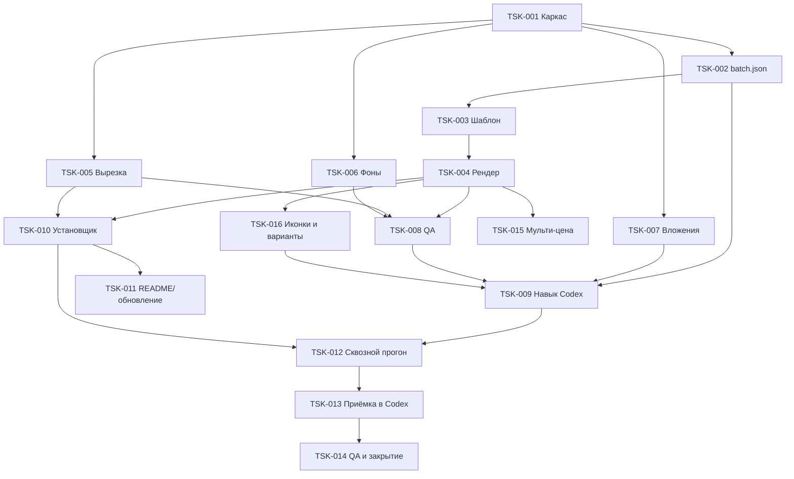

# Tasks: карточки товаров в дизайне Canva «Строительство и ремонт»

## Информация о документе

- **Фича**: canva-style-cards
- **Версия**: 1.0 (черновик на согласование)
- **Дата**: 2026-10-01
- **Связанные документы**: [requirements.md](requirements.md), [design.md](design.md)

## Стратегия

Гибрид:
1. минимальный фундамент;
2. сразу самый ценный срез — дизайн-слой и рендер (он уже подтверждён пробой);
3. риск-первым — забор вложений из Codex;
4. вырезка и фоны;
5. навык Codex;
6. установщик;
7. проверка на реальных товарах.

Каждая задача включает свои тесты. Задача закрыта, когда выполнен её пункт «Готово, когда».

## Фаза 1. Фундамент

- [x] **TSK-001**: Каркас проекта и окружение uv
  - Requirement: FR-10, NFR-3, NFR-6
  - Deliverables: `pyproject.toml`, `uv.lock`, `.python-version`, `komfort_cards/__init__.py`, `komfort_cards/__main__.py`, `komfort_cards/cli.py` (подкоманды-заглушки), `cards.cmd`, `assets/fonts/` (Open Sans 400/700, Montserrat 400/700 + `OFL.txt`), `assets/logo.png` (из файла владельца), `.gitignore` (+`input/`, `.venv/`, `setup.log`), `tests/conftest.py`
  - Готово, когда: на этом ПК `uv sync` создаёт `.venv`; `.\cards.cmd --help` выводит список команд; `pytest` запускается.

- [x] **TSK-002**: Модель партии `batch.json`, команды `init` и `check`
  - Requirement: FR-2, FR-3, FR-8
  - Deliverables: `komfort_cards/batch.py`, `komfort_cards/formatting.py`, тесты `tests/test_batch.py`, `tests/test_formatting.py`
  - Сделать:
    - схема и валидация по design.md;
    - цена — группы по 3 цифры, код — строка как есть;
    - запрет источника `knowledge` для чисел;
    - флаг `confirmed`;
    - markdown-сводка для сверки;
    - создание партии `YYYY-MM-DD_HHMM[_метка]`.
  - Готово, когда: тесты покрывают пустые код и цену, нечисловую цену, ведущие нули в коде, `00-00135412`, сводку на 5 строк.

## Фаза 2. Дизайн-слой и рендер

- [x] **TSK-003**: Шаблон `stroyka` по раскладке Canva
  - Requirement: FR-6, FR-7, NFR-1
  - Deliverables: `templates/stroyka/card.html`, `card.css`, `fit.js`
  - Сделать:
    - все элементы из таблицы раскладки design.md: градиенты 0–430 и 733–1350, заголовок с трекингом −0.02em и акцентом, строка-подзаголовок или белая плашка в 1–2 строки, зелёная плашка с «+», логотип из файла, код, цена, ₸ в SVG;
    - локальный `@font-face`;
    - зона товара 900×720 с контактной и мягкой тенью;
    - переопределения `layout`;
    - `window.__metrics`.
  - Готово, когда:
    - визуально совпадает с пробой v7 (`prototype/card-v7.html`): цена +25% к эталону, полупрозрачная зелёная плашка по схеме Canva, зазор над товаром;
    - длинный заголовок уменьшается и переносится без искажения пропорций.

- [x] **TSK-004**: Рендерер `render`
  - Requirement: FR-7, FR-8, NFR-2, NFR-3
  - Deliverables: `komfort_cards/render.py`, `tests/test_render.py`, `tests/golden/selftest.png`
  - Сделать:
    - Playwright с `channel="msedge"`, fallback на Chromium;
    - рендер партии или выбранных номеров;
    - запись `NN_<код>.png` без перезаписи (`_v2`, `_v3`);
    - метрики в `batch.json`.
  - Готово, когда:
    - интеграционный тест подтверждает позиции элементов ±2 px: заголовок left 78/top 84, правый край кода 998, правый край цены 933, правый край ₸ 997, логотип 101/1206;
    - golden-тест проходит (средняя разница < 2/255);
    - рендер одной карточки ≤ 10 с.

- [x] **TSK-016**: Варианты оформления: подзаголовок `line`, иконки-свойства `row` и `column`
  - Requirement: FR-15
  - Deliverables: `assets/icons/*.svg` (Lucide + LICENSE), `config/icons.yaml`, доработка `templates/stroyka/*`, проверки в `qa.py`, тесты в `tests/test_render.py`
  - Вариации из «К: УЛИЦА»: белая плашка параметра с зелёным значением; «+» двух цветов; бейдж «подпись + значение»; зелёный бейдж с ключевой цифрой; двухстрочный заголовок; выноски у частей товара (таблица «Словарь вариаций» в design.md).
  - Готово, когда:
    - рендер с 3 иконками в `row` и в `column` не пересекает товар и текст;
    - товар занимает ≥ 20% холста;
    - шрифты, цвета и позиции кода, цены и логотипа не меняются.

## Фаза 3. Товар и фон

- [x] **TSK-005**: Вырезка `cutout`
  - Requirement: FR-4, NFR-2
  - Deliverables: `komfort_cards/cutout.py`, `tests/test_cutout.py`, команда `setup-models`
  - Сделать:
    - rembg `isnet-general-use`;
    - удаление белой каймы и деконтаминация краёв;
    - обрезка по альфе, удаление «островов»;
    - `NN_check.jpg` на тёмной шахматке;
    - метрики и пороги `needs_review`.
  - Замерить размер и время установки rembg. Если больше 10 минут — перейти на прямой onnxruntime (решение D5 в design.md).
  - Готово, когда: синтетика «белое ведро на белом» и «цветная коробка на белом» вырезается с покрытием в ожидаемых пределах; кайма ≤ 1 px; одно фото на CPU ≤ 30 с.
  - Итог 2026-10-02:
    - установка rembg — 24 с и +307 МБ; модель — 170 МБ в `.models/`. Остаёмся на rembg (D5);
    - на 6 реальных фото вырезка занимает ~1 с на фото. Белые товары на белом фоне чистые;
    - добавлено «уплотнение» маски для плоских белых товаров и `photo_crop`;
    - ограничение: стекло получается «молочным», такие позиции идут на проверку.

- [x] **TSK-006**: Фоны и промпты: `prompt`, `background`
  - Requirement: FR-5
  - Deliverables: `komfort_cards/background.py`, `komfort_cards/prompts.py`, `config/scenes.yaml`, `tests/test_background.py`, `tests/test_prompts.py`
  - Сделать:
    - сборка промпта из общего стиля и категории;
    - забор самого нового файла из `~/.codex/generated_images/<thread>` или по `--file`;
    - обрезка однотонной рамки 1–3 px;
    - cover-crop до 1080×1350;
    - хранение попыток `NN_tryK`.
  - Готово, когда: тест на синтетике 1122×1402 с рамкой даёт 1080×1350 без рамки; для каждой категории промпт содержит запреты (текст, товары, люди, логотипы).

## Фаза 4. Интеграция с Codex

- [x] **TSK-007**: Забор вложений `collect`
  - Requirement: FR-1
  - Deliverables: `komfort_cards/collect.py`, `tests/test_collect.py` + синтетические rollout-файлы в `tests/fixtures/`
  - Сделать:
    - поиск свежего rollout;
    - картинки последнего пользовательского сообщения: пути `local_image`, иначе base64 `input_image`;
    - `--table-index`, `--count`;
    - fallback на `input/` с натуральной сортировкой;
    - понятные ошибки, код 2.
  - Готово, когда: тесты покрывают все три источника и несовпадение количества; ручная проверка на реальной сессии Codex этого ПК (только чтение).
  - Итог 2026-10-02: на реальном журнале найдено вложение `codex-clipboard-*.png`. Дополнительно — команда `table` для точного чтения .xlsx без распознавания.

- [x] **TSK-008**: Контроль качества `qa`, превью, `status`
  - Requirement: FR-8, FR-9
  - Deliverables: `komfort_cards/qa.py`, `tests/test_qa.py`
  - Сделать:
    - автопроверки из design.md (C6);
    - статусы и `issues` в `batch.json`;
    - `preview.jpg` 4 в ряд с номерами;
    - итоговый отчёт на русском.
  - Готово, когда: тесты ловят переполнение текста, пустую цену, товар вне зоны, неверный размер.

- [x] **TSK-009**: Навык Codex `komfort-cards`, AGENTS.md, вывод старого потока
  - Requirement: FR-1 … FR-9, FR-13
  - Deliverables:
    - `.agents/skills/komfort-cards/SKILL.md`, `references/text-rules.md` (правила и примеры текстов из эталона), `references/design-rules.md`, `references/qa-checklist.md`, `agents/openai.yaml`;
    - новый `AGENTS.md`;
    - перенос старого навыка и скриптов в `legacy/`, их незакоммиченные правки — отдельным коммитом до переноса.
  - Готово, когда: SKILL.md проходит по всему потоку design.md без пропусков; Codex по фразе «сделай карточки» выбирает новый навык; старого навыка нет в `.agents/skills/`.
  - Итог 2026-10-02:
    - поток SKILL.md пройден командами на 3 реальных фото: collect → check → confirm → cutout → background → render → review → status;
    - выбор навыка Codex проверяется в TSK-013;
    - добавлен CLAUDE.md, импортирующий AGENTS.md.

## Фаза 5. Развёртывание

- [x] **TSK-010**: Установщик `УСТАНОВКА.bat` и самопроверка
  - Requirement: FR-10, NFR-5
  - Deliverables: `УСТАНОВКА.bat`, `scripts/setup.ps1`, `assets/selftest/` (процедурные фон и товар), команда `selftest`
  - Сделать:
    - uv без прав администратора;
    - `uv sync --frozen`;
    - модель вырезки;
    - проверка Edge и fallback;
    - selftest;
    - сообщения на русском, `setup.log`;
    - повторный запуск безопасен.
  - Готово, когда: на этом ПК (Python не установлен) двойной клик доводит до «Готово» и `output/_selftest/card.png`; повторный запуск не ломает установленное.
  - Итог 2026-10-02:
    1. Чистый клон в глубокую папку с кириллицей и пробелом упал на шаге модели: кэш numba внутри site-packages превысил лимит пути Windows в 260 символов. Исправлено: кэш перенесён в `.models/numba`, установщик предупреждает о длинном пути.
    2. Повтор в той же папке — «ГОТОВО» за 63 с.
    3. Клон в короткой папке без uv в PATH — официальный установщик поставил uv, затем Python 3.12, модель, Edge и самопроверка; «ГОТОВО» за 69 с.

- [x] **TSK-011**: Обновление и README для оператора
  - Requirement: FR-11, FR-12
  - Deliverables: `ОБНОВЛЕНИЕ.bat`, `scripts/update.ps1`, `README.md`
  - Сделать:
    - установка;
    - «как сделать карточки» за 3 шага;
    - где результат;
    - типовые ошибки и что делать;
    - как обновиться.
  - Готово, когда: README понятен человеку без технической подготовки — проверка чтением владельцем.

## Фаза 6. Проверка

- [ ] **TSK-012**: Сквозной прогон без Codex на реальных товарах
  - Requirement: все FR, NFR-1
  - Deliverables: прогон в `output/` (не коммитится), сравнение с эталоном Canva бок о бок
  - Сделать: 3–5 товаров из `images/` и временные фоны → карточки; исправить отклонения от эталона.
  - Готово, когда: владелец подтверждает, что дизайн-слой совпадает с Canva.
  - Ход 2026-10-02:
    - прогон `output/2026-10-02_0018_e2e-проба` (корзина, статуэтка, бетономешалка с `photo_crop`): 3 карточки за 3 с, автопроверки пройдены;
    - коды и цены взяты с komfort.kz;
    - фон — временный процедурный;
    - ждём подтверждения владельца.

- [ ] **TSK-013**: Приёмочный прогон в Codex (выполняет владелец)
  - Requirement: FR-1, FR-5, FR-9
  - Сделать: в Codex на этом ПК прикрепить 3–5 фото и таблицу → карточки; разобрать найденные проблемы.
  - Готово, когда: партия проходит от вложений до отчёта без ручной работы с файлами.

- [ ] **TSK-014**: QA-проход и закрытие спеки
  - Requirement: все
  - Сделать:
    - скилл `quality-assurance`: покрытие требований, evidence;
    - статус требований в `requirements.md`;
    - синхронизация `tasks.md`;
    - commit + push.
  - Готово, когда: все Must-требования имеют evidence.

## Фаза 6b. Доработки по приёмке

- [x] **TSK-017**: Меньше лишних перегенераций фона, выбор любого фона из чата
  - Requirement: FR-5 (AC-5.2, AC-5.3)
  - Deliverables:
    - `cards generations` — номера генераций чата;
    - `background N --pick K`;
    - новые правила в SKILL.md: только объективные дефекты и максимум 1 повтор, сначала фоны для всех позиций, вкус решает оператор, реакция на «стоп, фон нормальный»;
    - тесты.
  - Готово, когда: тест выбирает генерацию №1 для позиции; SKILL.md не разрешает улучшения «на вкус»; в новом чате Codex принимает первый фон без дефектов.
  - Итог 2026-10-02: команда и тест готовы, правила в SKILL.md обновлены. Поведение в новом чате Codex проверяется при приёмке (TSK-013).

- [x] **TSK-018**: Режим «сцена с товаром» (D1-v2) — основной
  - Requirement: FR-4, FR-5, FR-6 (обновлены 2026-10-02)
  - Deliverables:
    - `config/scenes.yaml`: промпт «товар по референсу в сцене»; наборы поверхностей и интерьеров по категориям, чередуются в партии;
    - `cards prompt N` — промпт и путь к референсу; `cards reference N` — чистый референс с учётом `photo_crop`;
    - `background N` — определение рамки товара на кадре;
    - `render`: без слоя вырезки в режиме `scene`; `bg_zoom` и `bg_shift_y`; запасной режим `composite`;
    - новые шаги SKILL.md;
    - тесты.
  - Готово, когда:
    - тесты подтверждают чередование поверхностей, рамку товара на сцене, сдвиг и приближение без пустых полей, рендер без вырезки;
    - партия в Codex даёт товары, вписанные в сцену.
  - Итог 2026-10-02: код, тесты и SKILL.md готовы, 100 тестов и selftest проходят. Как Codex вписывает товары в сцену, проверяет владелец на следующей партии (TSK-013).

- [x] **TSK-019**: Защита режима сцены от самовольной вклейки и обходов
  - Requirement: FR-4
  - Deliverables:
    - AGENTS.md под D1-v2;
    - проверки `composite_reason` в `prompts.item_mode`, `render`, `cutout`;
    - запрет самодельных вырезок в `render`;
    - чередование сцен в composite-промпте;
    - запреты в SKILL.md;
    - тесты в `tests/test_scene_mode.py`.
  - Итог 2026-10-02: 104 теста и selftest проходят.

## Фаза 7. Опционально

- [ ] **TSK-015**: Карточка с несколькими вариантами (стр. 105 эталона)
  - Requirement: FR-14 (Could)
  - Deliverables: вариант шаблона `multi`, поддержка в `batch.json` и `render`

## Граф зависимостей

## Прогресс

| Задача | Статус |
|---|---|
| TSK-001 Каркас проекта и окружение | Complete |
| TSK-002 Модель партии, init/check | Complete |
| TSK-003 Шаблон stroyka | Complete |
| TSK-004 Рендерер | Complete |
| TSK-005 Вырезка | Complete |
| TSK-006 Фоны и промпты | Complete |
| TSK-007 Забор вложений | Complete |
| TSK-008 QA, превью, status | Complete |
| TSK-009 Навык Codex, AGENTS.md, legacy | Complete |
| TSK-010 Установщик и selftest | Complete |
| TSK-011 Обновление и README | Complete |
| TSK-012 Сквозной прогон | In Progress (ждёт подтверждения владельца) |
| TSK-013 Приёмка в Codex | Pending |
| TSK-014 QA и закрытие | Pending |
| TSK-015 Мульти-цена (Could) | Pending |
| TSK-016 Иконки-свойства и варианты (Should) | Complete |
| TSK-017 Меньше перегенераций, выбор фона из чата | Complete (поведение Codex — в TSK-013) |
| TSK-018 Режим «сцена с товаром» | Complete (проверка в Codex — TSK-013) |
| TSK-019 Защита режима сцены | Complete |
